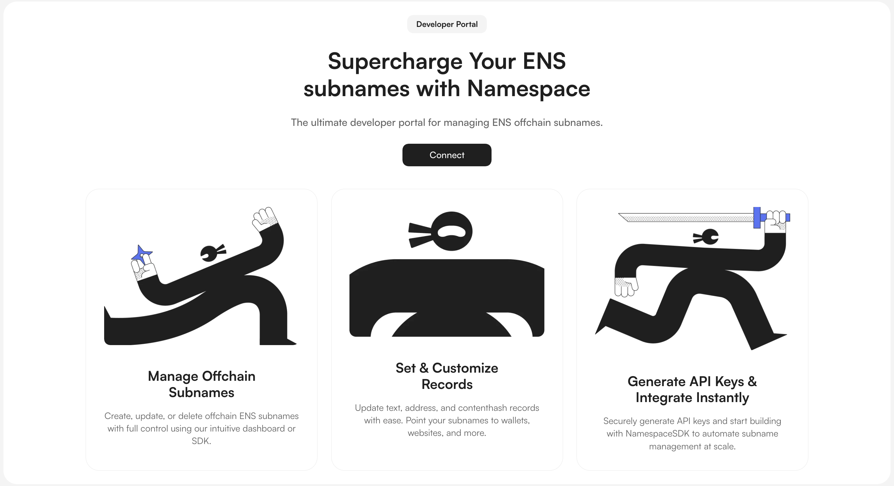
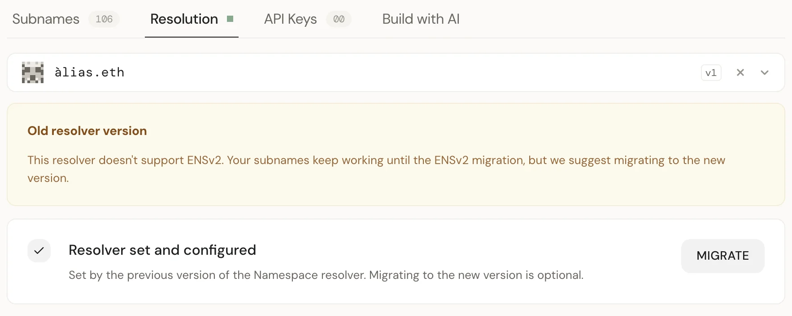
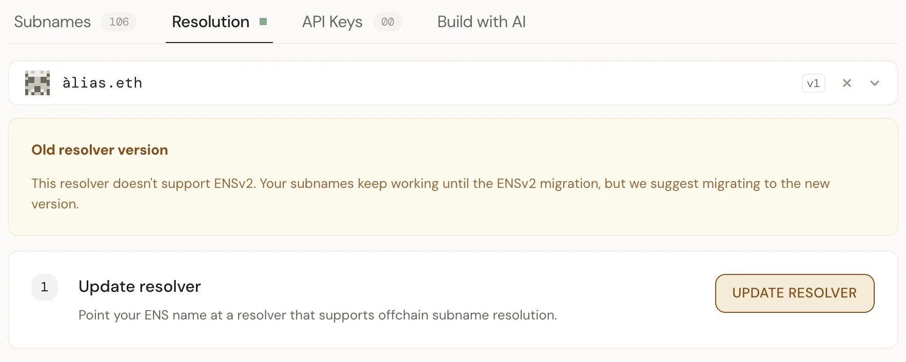
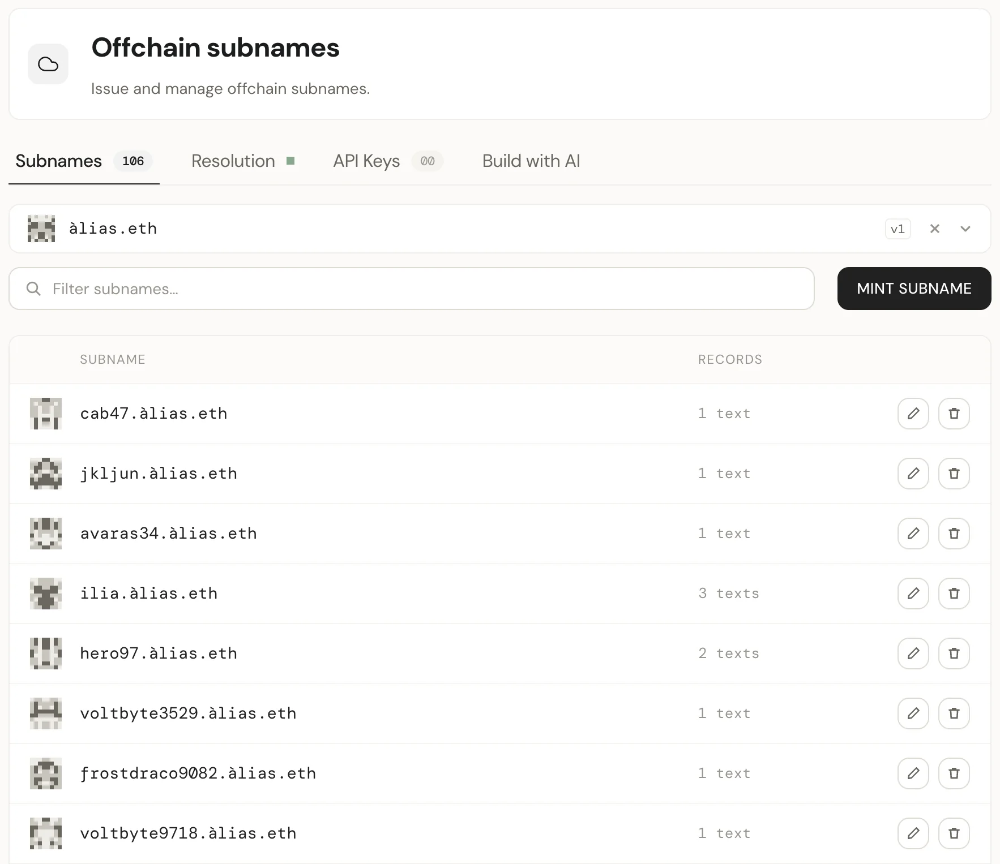
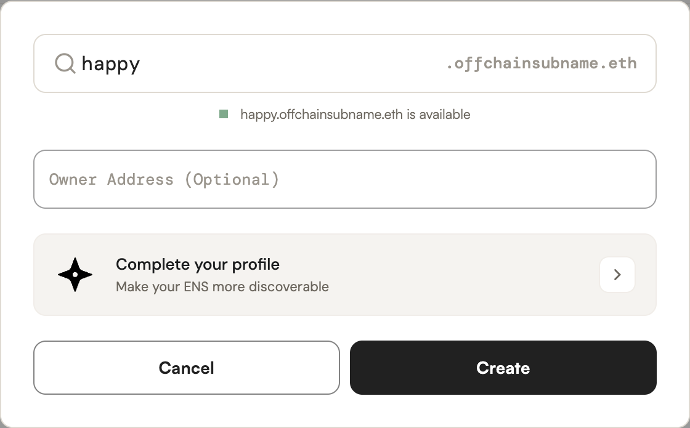
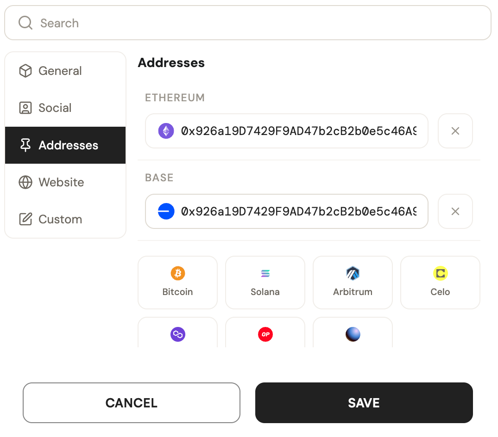
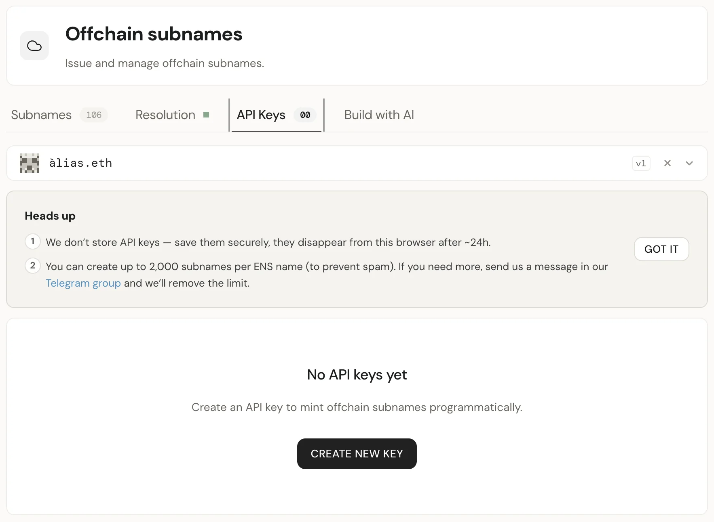
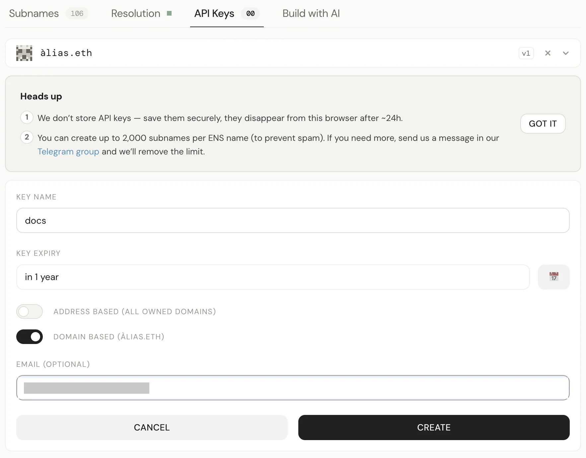

Create ENS subnames under a name you own in the [Namespace App](https://app.namespace.ninja/offchain). Namespace stores these subnames and their records offchain. They are not minted as onchain NFTs. ENS clients resolve their records through CCIP Read.

Creating, editing, and deleting offchain subnames and their records is free. These actions require no blockchain transactions or gas fees.

## What you can do

- Create, edit, and delete subnames under your ENS name.
- Set EVM and non-EVM addresses, profile and social text records, and a content hash.
- Index subnames by their optional owner address.
- Manage subnames in the app or automate through the SDK and API.

## Configure the resolver

Point the parent ENS name at the Namespace Hybrid Resolver so its subnames resolve. This takes an onchain transaction and gas fees. If the **Resolution** tab already shows **Resolver set and configured** with **Done**, skip this section.

<Tip>
  If you upgrade an ENSv1 name to ENSv2, the upgrade resets its resolver. Run these steps again afterwards. See [Namespace ENSv2 migration](/overview/ensv2#what-happens-if-i-upgrade-my-name-to-ensv2).
</Tip>

<Steps>
  <Step title="Select your parent name">
    Connect the wallet that owns the ENS name. Open **Offchain subnames** in the sidebar, select the name, and open **Resolution**.
  </Step>

  <Step title="Migrate from the old resolver">
    Skip this step if you don't see an **Old resolver version** warning.

    Names set up with the previous Namespace resolver show the warning above **Resolver set and configured**. Their subnames keep resolving until the ENSv2 migration, but the old resolver doesn't support ENSv2. Click **Migrate** to switch to the current resolver.

    <Frame>
      
    </Frame>
  </Step>

  <Step title="Update the resolver">
    Click **Update resolver** and confirm in your wallet. The button reads **Set resolver** if the name uses a resolver from outside Namespace, or none.

    <Frame>
      
    </Frame>

    If the current resolver holds records, such as an address or avatar, the app lists them under **Transfer records** and copies them to the new resolver by default. Some wallets need a separate transaction for the copy. The step shows how many transactions it takes.
  </Step>

  <Step title="Check the status">
    After the transaction confirms, the step reads **Resolver set and configured** with **Done**. If it reads **Enable offchain resolution**, click **Enable** and confirm in your wallet.
  </Step>
</Steps>

## Create and manage subnames

<Steps>
  <Step title="Open the creation form">
    Select the parent name in **Subnames**, then click **Mint subname**.

    <Frame>
      
    </Frame>
  </Step>

  <Step title="Create a subname">
    Enter a label, such as `happy`, and check availability.

    **Owner Address** is optional and can be used for indexing subnames by owner.

    Add records through **Complete your profile**, or add them later. Click **Create**.

    <Frame>
      
    </Frame>
  </Step>

  <Step title="Edit the subname's records">
    Click the subname's pencil icon. Edit its address, text, or content hash records, then click **Save**.

    <Frame>
      
    </Frame>
  </Step>
</Steps>

To delete a subname, click its trash icon.

## Create an API key

API keys are required for SDK and API access, not for using the app.

<Card title="Create an API key" icon="key" horizontal href="https://app.namespace.ninja/offchain?activeTab=apiKeys">
  Open API Keys in the Namespace App.
</Card>

<Steps>
  <Step title="Open API Keys">
    Select the parent name, open **API Keys**, and click **Create new key**.

    <Frame>
      
    </Frame>
  </Step>

  <Step title="Set the key's expiry and scope">
    Enter a key name, set an expiry date, and choose a scope:

    | Scope | Access | Best used for |
    | --- | --- | --- |
    | Address based | All ENS names owned by the connected wallet | Managing multiple parent names |
    | Domain based | Only the selected parent name | Restricting an integration to one parent name |

    Email is optional. Click **Create**.

    <Frame>
      
    </Frame>
  </Step>

  <Step title="Copy and store the key">
    Store the key in a server-side environment variable or secret store. Never expose it in browser code or public repositories.

    Copy it before it disappears from the browser after about 24 hours. The key remains valid until its expiry date or revocation.
  </Step>
</Steps>

<Note>
  Limit: 2,000 subnames per parent name. For a higher limit, contact the [Builders group](https://t.me/+5FAwyiKOTeswNTIy).
</Note>

## Next steps

<CardGroup cols={2}>
  <Card title="Integrate offchain subnames" icon="code" href="/developer-guide/guide/create-offchain-subnames">
    Create and query subnames with the SDK.
  </Card>
  <Card title="Troubleshoot resolution" icon="screwdriver-wrench" href="/developer-guide/troubleshooting">
    Fix name and record lookup failures.
  </Card>
</CardGroup>
